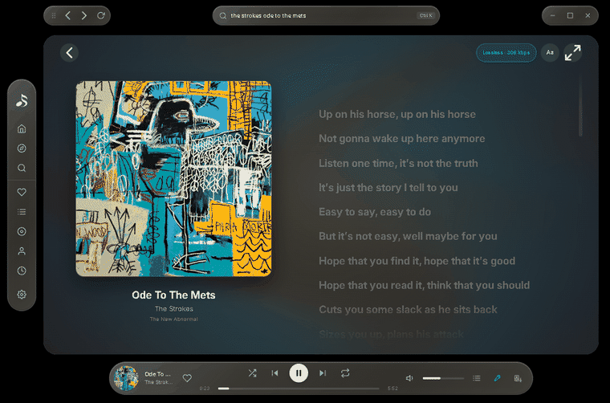
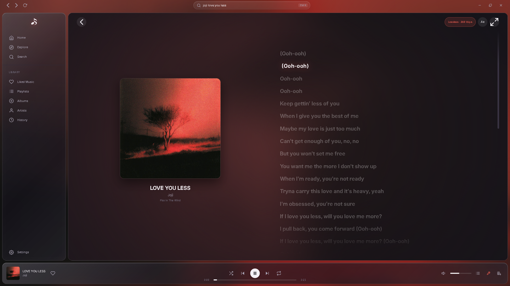
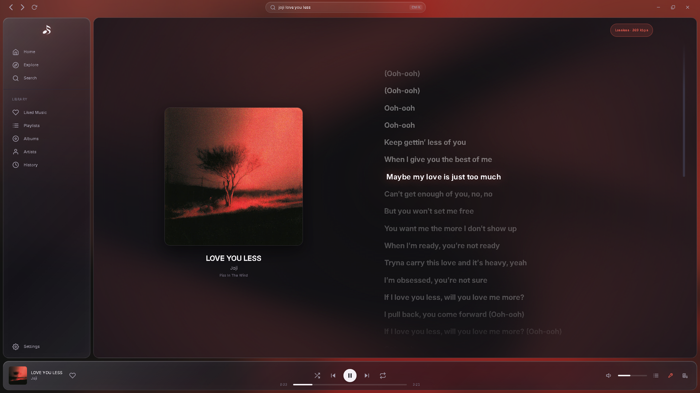
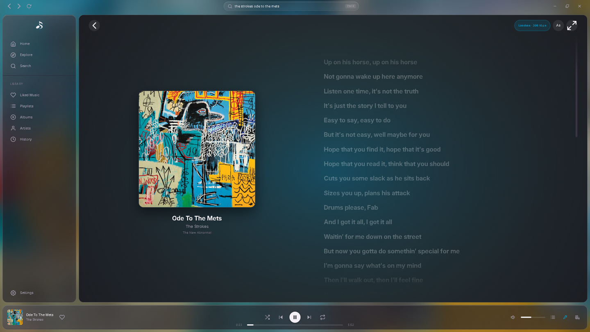
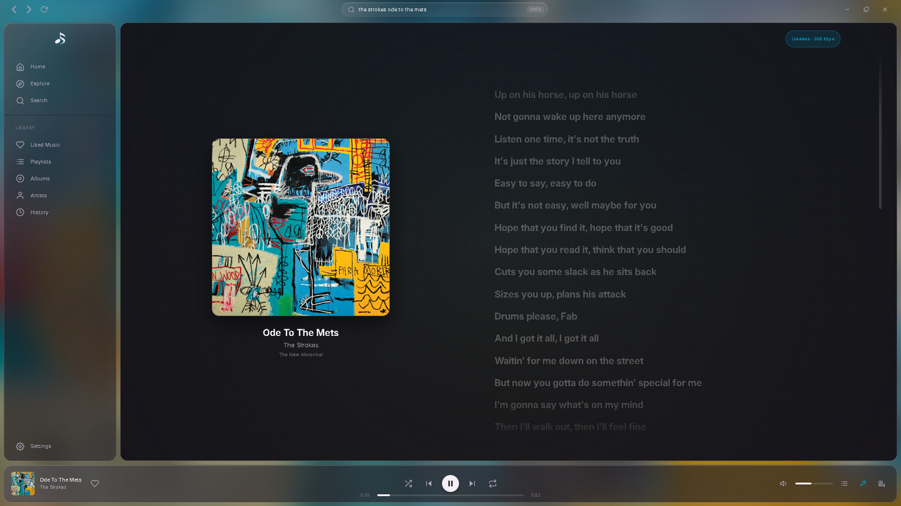
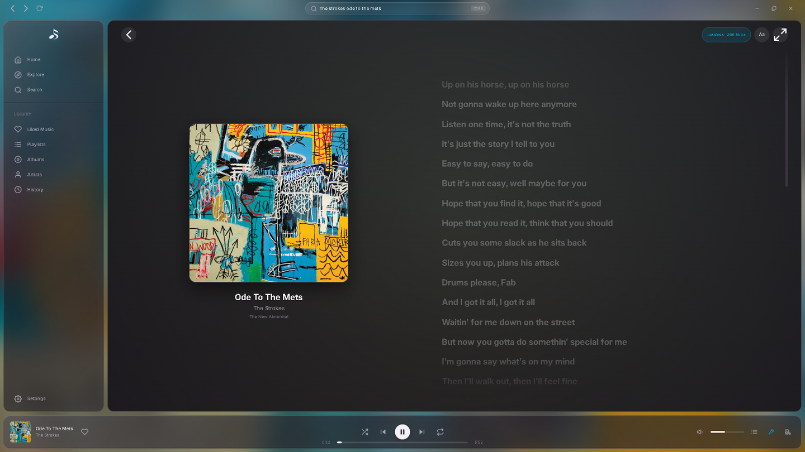
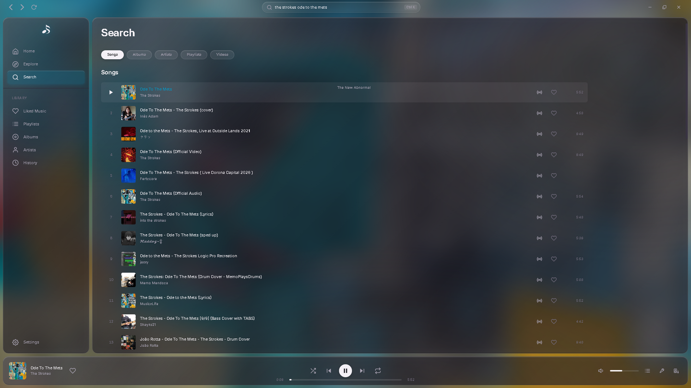
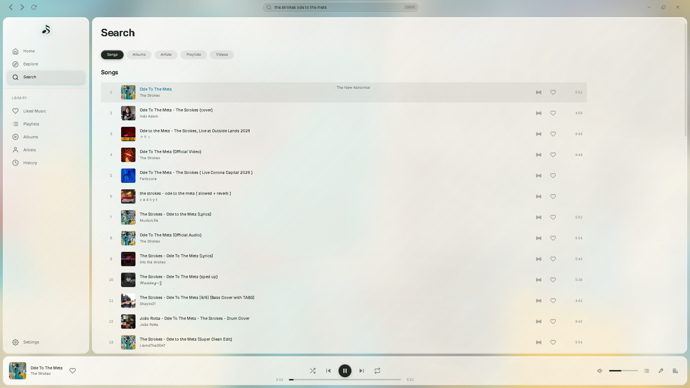
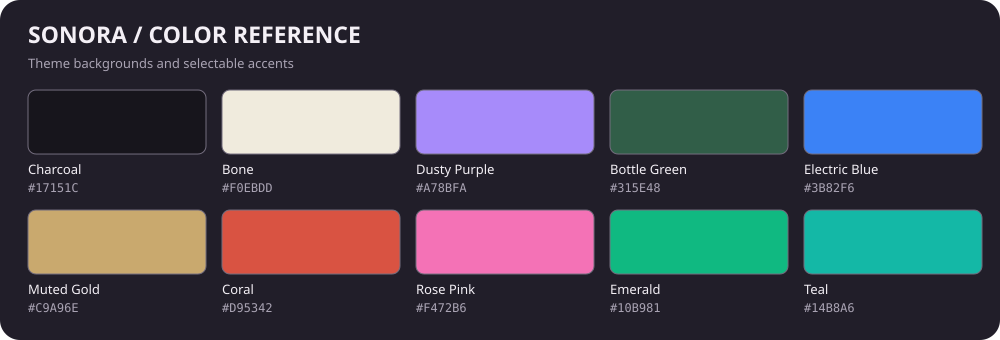
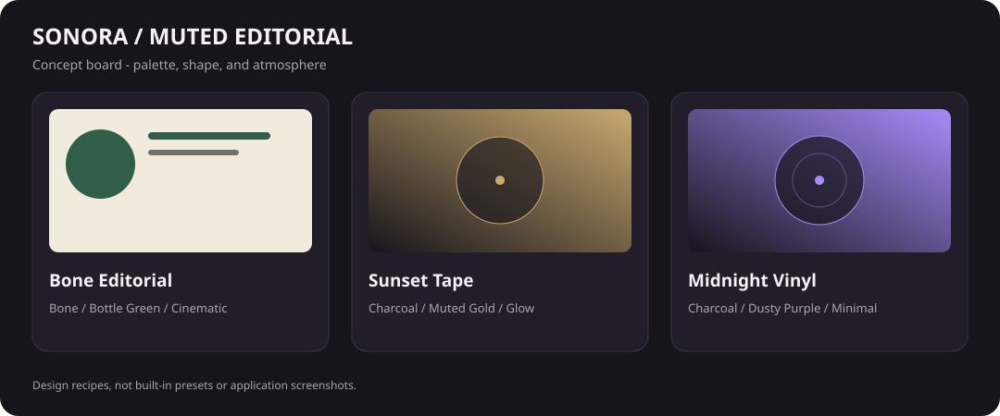

<div align="center">
  
  <h1>Sonora</h1>
  <p><strong>A lightweight Windows desktop client for YouTube Music with artwork-driven visuals.</strong></p>

  [](https://github.com/shrenixcodes/sonora/actions/workflows/ci.yml)
  [](https://github.com/shrenixcodes/sonora/releases/latest)
  [](LICENSE)
  [](#install)
  [](https://v2.tauri.app/)

  <br /><br />
  
  <br />
  <sub>Liquid splash intro revealing Sonora's floating window, adaptive artwork backdrop, and synced lyrics (<em>Joji — LOVE YOU LESS</em>).</sub>
</div>

Sonora combines a vanilla TypeScript interface and WebGL ambience with a Tauri 2 / Rust desktop shell. Playback and catalog requests run through the official YouTube Music web app inside an isolated WebView2 profile. Sonora is a community project and is not affiliated with or endorsed by Google or YouTube Music.

> **Windows-only desktop target:** Sonora targets **Windows 10 / 11 (x64)** with Microsoft Edge WebView2. `pnpm dev` runs the frontend UI in a browser for layout work, while playback, Google account access, ad filtering, Windows SMTC media keys, click-through floating mode, and per-app audio output routing require the native Windows application.

---

## Visual Direction

Real desktop captures from the Windows release build showing floating window framing, synced LRCLIB lyrics, and adaptive artwork palettes:

### Live Floating Window Previews

| Fluid Visualizer (`Floating Window`) | Taskbar Restore (`Minimized → Restored`) |
| :---: | :---: |
|  |  |
| Continuous domain-warped shader ribbons behind synced lyrics | Vinyl artwork emerge burst restoring from minimized/taskbar state |

### Visualizer Modes (`Now Playing`)

| Aurora | Fluid |
| :---: | :---: |
|  |  |

| Glow | Cinematic | Minimal |
| :---: | :---: | :---: |
|  |  |  |

| Mode | Shader Effect | Behavior |
| --- | --- | --- |
| **Aurora** | Layered 2D value-noise auroral ribbons | Continuous at 15 / 30 / 60 FPS |
| **Fluid** | Iterative sine/cosine domain-warped waves | Continuous at 15 / 30 / 60 FPS |
| **Glow** | Breathing radial bloom centered behind artwork | Continuous at 15 / 30 / 60 FPS |
| **Cinematic** | Top/bottom stage spotlights with dark circular vignette | Pauses loop once palette converges |
| **Minimal** | Soft diagonal wash across dominant & vibrant hues | Pauses loop once palette converges |
| **None** | Solid `#17151C` stage (no WebGL render loop) | Stopped |

See [the shader reference](docs/design/shaders.md) for GLSL uniform and color-extraction details.

### Theme Foundations (Dark vs. Light)

| Dark Theme (`Charcoal`) | Light Theme (`Bone`) |
| :---: | :---: |
|  |  |

| Aspect | Dark Theme (`Charcoal`) | Light Theme (`Bone`) |
| --- | --- | --- |
| **Base / Surface** | `#17151C` / `#211E29` (`#292532` elevated) | `#F0EBDD` / `#F8F5EC` (`#E7E2D4` elevated) |
| **Primary / Secondary Text** | `#F4F0F6` / `#A9A3B3` | `#202820` / `#6C7169` |
| **Default Accent** | Dusty Purple `#A78BFA` (secondary `#C9A96E`) | Bottle Green `#315E48` (secondary `#D95342`) |
| **Now Playing Stage** | Dark `#17151C` theater backdrop | Always dark `#17151C` over shaders for contrast |
| **Artwork Accent Adaptation** | WCAG AA `4.5:1` contrast-clamped `palette.vibrant` | WCAG AA `4.5:1` contrast-clamped `palette.vibrant` |

<details>
<summary>Design token sheets & mood board references (<code>SVG</code> / <code>JSON</code>)</summary>





Color tokens, presets, and capture guidelines live in [DESIGN.md](DESIGN.md), [docs/design/palette.json](docs/design/palette.json), and [the capture guide](docs/design/captures.md).

</details>

---

## Features

### Playback, Queue & Discovery
- **Search & Catalog Browsing:** Debounced search across **Songs**, **Albums**, **Artists**, **Playlists**, and **Videos** (with automatic audio playback fallback for music uploaded as YouTube videos), plus Home mood chips, Explore's 8 Mood & Genre shortcuts, and dedicated Artist & Collection pages.
- **Queue & Song Radio:** Persistent player dock with elastic seek bar, **Up Next** side drawer with grip-handle drag reordering, **Autoplay Next**, shuffle/repeat (`Off`, `All`, `One`), and **Song Radio** (queues up to 25 YouTube Music recommendations and replenishes automatically).
- **Song Context Menu & Local Playlists:** Right-click (or press `Shift+F10` / `ContextMenu`) on tracks to **Play Next**, **Add to Queue**, **Add to Playlist**, **Start Song Radio**, **Go to Artist**, **Go to Album**, or **Copy Link**. Local Sonora playlists and history are stored separately from YouTube Music account playlists, while liked songs and history sync when signed in.
- **Windows Media Controls (SMTC):** Supports keyboard hardware media keys and Windows lock-screen / overlay transport controls.

### Lyrics & Now Playing
- **Synchronized Lyrics:** Fetches timed and plain lyrics from [LRCLIB](https://lrclib.net/) with click-to-seek navigation and configurable text sizes (`Small`, `Medium`, `Large`, or `Off` for centered enlarged artwork).
- **Immersive Fullscreen:** Toggle fullscreen presentation from Now Playing (`Esc` to exit) with live audio quality badge access.

### Audio Quality, Mastering & Per-App Routing
- **Quality & DSP Tiers:** Choose **Saver**, **Balanced**, **High** (default), or **Lossless**, with automatic fallback to the best available YouTube Music stream when higher tiers stall or are unavailable. **Lossless** pairs peak available stream bitrates with a 64-bit Web Audio mastering chain (subsonic filter, harmonic air restoration, true-peak limiter); it cannot reconstruct lossless PCM from a compressed source.
- **Enhancement Profiles & Telemetry:** Five profiles (`Pure (Unaltered)`, `Studio Clarity`, `Warm & Smooth`, `Deep Bass`, `Vocal Focus`), **Normalize Volume**, and live codec / bitrate / sample-rate / DSP gain telemetry.
- **Per-App Windows Audio Output:** Route only Sonora's process tree (`sonora.exe` + WebView2 children) to any wired, wireless, or Bluetooth playback device via Windows Core Audio (`AudioPolicyConfig`) without changing Windows' system default output.

### Appearance Studio & Desktop Experience
- **Customization:** Switch Dark (`Charcoal`) / Light (`Bone`) themes, pick **Theme Default** or any of 8 accent colors (`Dusty Purple`, `Bottle Green`, `Electric Blue`, `Muted Gold`, `Coral`, `Rose Pink`, `Emerald`, `Teal`), switch **Comfortable** / **Compact** density, pick visualizer mode & FPS (`15`, `30`, `60`), preview launch/restore animations, and export/import `sonora-theme.json`. *(Note: `ambientIntensity` is configured through `sonora-theme.json`; Settings does not show a separate intensity slider.)*
- **Floating & Full Layouts:** Unmaximized windows enter a transparent click-through floating layout with detached glass islands, custom edge resize handles, elastic rubberband overscroll, and a `210ms` morph animation when maximizing/restoring.
- **WebGL2 Symbiote Animations:** Liquid metaball launch splash (`F8`) and spinning-vinyl taskbar restore (`F9`), both honoring reduced-motion preferences.
- **Extras & Updates:** Built-in Windows ad filtering powered by `adblock-rust` with EasyList/Brave rule lists (cannot guarantee blocking every upstream ad), auto-reconnecting **Discord Rich Presence**, and automatic **GitHub Releases** update checks & NSIS installer downloads on launch or in **About Sonora**.

---

## Install

Download the latest Windows x64 NSIS installer (`Sonora_*_x64-setup.exe`) from [GitHub Releases](https://github.com/shrenixcodes/sonora/releases/latest), run it, and launch Sonora. Note that the latest published release may differ from the tip of `main`.

### Build from Source

#### Prerequisites

- **OS & Runtime:** Windows 10 or Windows 11 (x64) with the Microsoft Edge WebView2 runtime (pre-installed on Windows 11 and most Windows 10 systems).
- **Node.js:** `20.19.0+` (20.x line) or `22.12.0+` (as required by Vite 8).
- **pnpm:** `12.21.0` (pinned via `packageManager` in [package.json](package.json)).
- **Rust:** Stable toolchain (`msvc` target) with Visual Studio C++ Build Tools — see [Tauri's Windows prerequisites](https://v2.tauri.app/start/prerequisites/#windows).

#### Setup & Run

```powershell
git clone https://github.com/shrenixcodes/sonora.git
cd sonora
pnpm install --frozen-lockfile
pnpm tauri:dev
```

If `pnpm` is not installed yet, run `npm install --global pnpm@12.21.0` (or enable Corepack). No `.env` file or API key is needed for normal usage or builds; see [.env.example](.env.example) for optional `TAURI_DEV_HOST` and `RUST_LOG` variables.

---

## Quick Start

1. Launch Sonora and browse **Home**, **Explore**, or **Search** (`Ctrl+K`). To access your YouTube Music library, personalized Home shelves, and Premium quality streams, click **Sign in** under **Settings → Account**.
2. Click any song or collection play button to start playback. Use the bottom player bar and **Up Next** panel to reorder tracks (via drag grips), adjust volume, or switch Sonora's per-app audio output device.
3. Right-click any track (or press `Shift+F10`) to queue it next, add it to a local playlist, start **Song Radio**, or jump to its artist or album.
4. Click the microphone lyrics button (`F` or track artwork) to open **Now Playing** with synchronized lyrics and WebGL ambient shaders, and tune themes, audio quality, or EQ profiles in **Settings**.

---

## Configuration & Theme Portability

All user preferences (`sonora:settings`), liked track caches (`sonora:liked_tracks`), local playlists (`sonora:playlists`), listening history (`sonora:history`, up to 200 tracks), and queue state (`sonora:queue`) are stored locally, while your YouTube Music sign-in session lives in an isolated WebView2 profile.

**Settings → Appearance Studio → Theme Configuration** exports and imports `sonora-theme.json` containing appearance keys only (`theme`, `accentColor`, `ambientMode`, `ambientFpsLimit`, `ambientIntensity`, `density`, `lyricsFontSize`):

```json
{
  "theme": "dark",
  "accentColor": "#C9A96E",
  "ambientMode": "glow",
  "ambientFpsLimit": 30,
  "ambientIntensity": 0.6,
  "density": "comfortable",
  "lyricsFontSize": "md"
}
```

Ready-to-import mood recipes (`Sunset Tape`, `Midnight Vinyl`, `Bone Editorial`) live in [docs/design/presets/](docs/design/presets/sunset-tape.json). Theme exports do **not** include playlists, account data, audio preferences, or your WebView2 profile. See [the audio & configuration guide](docs/audio-and-configuration.md) for full details.

---

## Development & Production Build

```powershell
pnpm dev          # Frontend only (Vite dev server at http://localhost:1430; supports ?window=floating)
pnpm preview      # Preview production frontend bundle in browser
pnpm tauri:dev    # Full Windows desktop app with YouTube Music & native Rust bridge
pnpm lint         # ESLint across src/
pnpm check        # TypeScript strict type check (tsc --noEmit)
pnpm test         # Vitest unit & integration suite (jsdom)
pnpm build        # Production frontend bundle (tsc && vite build -> dist/)
pnpm tauri:build  # Production Windows executable and NSIS installer
```

Rust backend checks (run inside `src-tauri/`):

```powershell
cd src-tauri
cargo fmt --check
cargo test --locked
```

`pnpm tauri:build` writes the Windows NSIS installer under `src-tauri/target/release/bundle/nsis/`.

---

## Keyboard Shortcuts

| Key | Action |
| --- | --- |
| `Ctrl+K` | Focus search (works from anywhere, including inputs) |
| `Space` | Play or pause playback |
| `Left` / `Right` | Seek backward / forward 5 seconds (also steps focused sliders) |
| `Up` / `Down` | Raise / lower volume by 5% (also steps focused sliders) |
| `M` | Mute or unmute audio |
| `L` | Toggle like on the current track |
| `F` | Open or leave **Now Playing** |
| `Esc` | Exit fullscreen lyrics in Now Playing, blur search, or close open menus |
| `Shift+F10` / `ContextMenu` | Open song actions menu for a focused track |
| `Home` / `End` | Jump to start or end of focused sliders and menus |
| `Enter` / `Space` | Activate focused track, card, player artwork, or title |
| `F8` / `F9` | Preview launch splash (`F8`) and taskbar restore animation (`F9`) |
| Hardware media keys | Windows SMTC Play/Pause, Next, and Previous track controls |

Global playback shortcuts (`Space`, arrows, `M`, `L`, `F`) are ignored while typing inside text fields or dropdowns.

---

## Tech Stack & Architecture

| Layer | Technology |
| --- | --- |
| **Desktop Shell & IPC** | [Tauri 2](https://v2.tauri.app/) (Rust 2024 edition) + Edge WebView2 |
| **Frontend** | Vanilla TypeScript (`ES2022`, strict mode) + modular CSS custom properties |
| **Build & Testing** | [Vite 8](https://vite.dev/), [Vitest 5](https://vitest.dev/) (JSDOM), ESLint 9 |
| **Graphics & Visualizers** | WebGL1 fragment shaders (`AmbientVisualRenderer`), WebGL2 metaballs (`GooRenderer`) |
| **Native Windows Features** | Windows Core Audio (`AudioPolicyConfig`), `adblock-rust`, `discord-rich-presence` |
| **Lyrics & Package Manager** | [LRCLIB](https://lrclib.net/) API, [pnpm](https://pnpm.io/) `12.21.0` |

See [docs/architecture.md](docs/architecture.md) for the two-window IPC architecture, WebView2 capability boundaries, and native command breakdown.

### Repository Map

```text
sonora/
├── .github/                  CI workflow, issue/PR templates, and CODEOWNERS
├── docs/
│   ├── architecture.md       Two-window IPC & Rust backend guide
│   ├── audio-and-configuration.md  Audio quality, DSP, per-app routing & storage schema
│   ├── design/               Palette exports (SVG/JSON), mood board, presets & shader docs
│   └── images/               Desktop splash/visualizer GIFs & theme/mode screenshots
├── public/                   Logo, favicon, placeholder artwork & Inter Variable font
├── src/
│   ├── components/           Titlebar, sidebar, player bar, queue panel, menus & dialogs
│   ├── icons/                Inline 24x24 SVG registry (UI + 24 audio device icons)
│   ├── lib/
│   │   ├── lyrics/           LRC parser & LRCLIB provider
│   │   ├── playback/         Playback engine, queue, song radio & YTM bridge
│   │   ├── visuals/          WebGL shaders, GooRenderer, symbiote & color extractor
│   │   └── ...               Theme, accent contrast, audio quality/devices, updater, router
│   ├── styles/               Design tokens, floating layout, glass surfaces & view CSS
│   ├── types/                Core TypeScript domain models
│   ├── views/                Home, Explore, Search, Library, Collection, Artist, Settings, Now Playing
│   └── main.ts               Bootstrap, routing, artwork ambience & global shortcuts
├── src-tauri/
│   ├── capabilities/         Tauri ACL permissions for main & isolated ytm windows
│   ├── filters/              Bundled EasyList / Brave filter lists & third-party notices
│   ├── icons/                Multi-resolution Windows application icons
│   ├── src/                  Rust backend (ytm, adblock, audio_devices, window_mode, discord, updater)
│   ├── Cargo.toml            Rust dependencies & metadata
│   └── tauri.conf.json       Tauri app config, CSP & NSIS bundling
├── tests/                    Vitest unit & integration suite
├── DESIGN.md                 Muted editorial design guide
├── CONTRIBUTING.md           Setup, verification checks & UI contribution rules
├── CHANGELOG.md              Release history
├── CODE_OF_CONDUCT.md        Community guidelines
├── SECURITY.md               Vulnerability reporting process
├── .env.example              Optional environment variable documentation
└── package.json              Node scripts & pinned pnpm@12.21.0 toolchain
```

---

## Contributing & Support

* **Contributing:** Read [CONTRIBUTING.md](CONTRIBUTING.md), [DESIGN.md](DESIGN.md), and the [Code of Conduct](CODE_OF_CONDUCT.md) before opening a pull request.
* **Bugs & Feature Requests:** Open an issue via [GitHub Issues](https://github.com/shrenixcodes/sonora/issues) using the issue templates (with personal data and tokens stripped).
* **Security:** Do not disclose security issues publicly — follow [SECURITY.md](SECURITY.md) to report privately via [GitHub Security Advisories](https://github.com/shrenixcodes/sonora/security).
* **Release History:** See [CHANGELOG.md](CHANGELOG.md).

---

## License & Acknowledgments

Sonora's source code is licensed under the [MIT License](LICENSE). Bundled third-party components retain their respective licenses:

* **Ad-filter engine & rule lists:** `adblock-rust` & Brave filter lists (MPL 2.0) and EasyList (CC BY-SA 3.0) — see [src-tauri/filters/NOTICE.txt](src-tauri/filters/NOTICE.txt).
* **Typography:** Inter Variable (SIL Open Font License 1.1) — see [public/fonts/Inter-LICENSE.txt](public/fonts/Inter-LICENSE.txt).
* **Ecosystem & libraries:** [YouTube Music](https://music.youtube.com/), [Tauri](https://v2.tauri.app/), Microsoft Edge WebView2, [LRCLIB](https://lrclib.net/), [`discord-rich-presence`](https://crates.io/crates/discord-rich-presence), and the open-source Rust and TypeScript ecosystems. All third-party names and marks belong to their respective owners.

<sub>Sample captures feature <em>Joji — LOVE YOU LESS</em> and <em>The Strokes — Ode To The Mets</em>.</sub>
