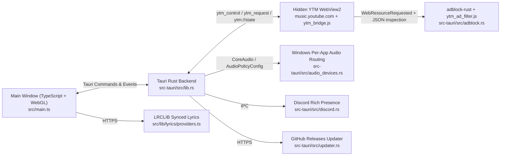

# Sonora Architecture & IPC Overview

Sonora pairs a lightweight vanilla TypeScript + WebGL frontend (`main` window) with a Rust/Tauri 2 backend and a hidden `music.youtube.com` WebView2 window (`ytm`).

## High-Level Process & Window Flow

## Two-Window Security Model

* **`main` window ([default.json](../src-tauri/capabilities/default.json)):** Runs the bundled frontend with CSP restricting external connections to `'self'`, Tauri IPC (`ipc:` / `http://ipc.localhost`), and `https://lrclib.net`. Artwork images load from Google/YouTube CDN origins (`lh3.googleusercontent.com`, `yt3.googleusercontent.com`, `yt3.ggpht.com`, `*.ytimg.com`).
* **`ytm` window ([ytm-bridge.json](../src-tauri/capabilities/ytm-bridge.json)):** Loads `https://music.youtube.com/` in its own isolated WebView2 profile so Google sign-in stays separate from the main app. Its capability grants **only** `allow-ytm-report` and `allow-ytm-response` on `https://music.youtube.com/*`. Closing the sign-in window hides it rather than terminating playback; exiting `main` closes the application ([lib.rs](../src-tauri/src/lib.rs)).

## Native Tauri Commands & Subsystems

| Module | Commands / Responsibilities |
| --- | --- |
| [commands.rs](../src-tauri/src/commands.rs) | `get_app_info`, `get_platform_info` — returns compiled crate version and host OS/architecture |
| [ytm.rs](../src-tauri/src/ytm.rs) | `ytm_control`, `ytm_request`, `ytm_report`, `ytm_response`, `ytm_set_signin_visible`, `ytm_sign_out` — bridges playback controls, audio config, account status, and catalog queries (`ytm://state`, `ytm://response`) |
| [adblock.rs](../src-tauri/src/adblock.rs) | Intercepts WebView2 network requests on Windows using `adblock-rust` (`0.13.6`) with bundled EasyList & Brave filter lists (refreshed at most once every 24h over HTTPS) alongside `ytm_ad_filter.js` |
| [audio_devices.rs](../src-tauri/src/audio_devices.rs) | `get_audio_output_devices`, `set_audio_output_device` — enumerates Windows Core Audio endpoints and routes Sonora's process tree (`sonora.exe` + WebView2 children) via `AudioPolicyConfig` |
| [window_mode.rs](../src-tauri/src/window_mode.rs) | `set_floating_regions`, `present_main_window` — samples cursor bounds (`50ms` active / `500ms` idle) in floating layout so transparent gaps pass clicks to the desktop; emits `sonora://will-minimize`, `sonora://minimize`, and `sonora://restore` |
| [discord.rs](../src-tauri/src/discord.rs) | `discord_set_activity`, `discord_clear_activity` — background worker maintaining Discord IPC (*Listening to Sonora*) with `15s` reconnect and `60s` keepalive refresh |
| [updater.rs](../src-tauri/src/updater.rs) | `check_for_updates`, `install_update` — checks GitHub Releases API, downloads the Windows NSIS installer to `%TEMP%\sonora-updates`, launches it, and exits |

## Frontend Layout & Routing

* **Views (`src/views/`):** Hash router ([router.ts](../src/lib/router.ts)) dispatches `/`, `/explore`, `/search`, `/liked`, `/playlists`, `/albums`, `/artists`, `/history`, `/playlist`, `/artist`, `/settings`, and `/now-playing`.
* **Persistent Shell (`src/components/`):** Titlebar (drag handle, history nav, refresh, `Ctrl+K` search, window controls), collapsible Sidebar / floating icon rail, Up Next queue panel (grip-handle reorderable), and bottom Player bar (playback controls, elastic seek slider, volume, queue/lyrics toggles, per-app output device menu).
* **Floating vs. Full Window Mode ([window-mode.ts](../src/lib/window-mode.ts)):** When unmaximized, `html[data-window="floating"]` switches the shell to detached rounded islands (`--stage-radius: 26px`) and reports interactive `HitRect` boxes via `set_floating_regions`. Browser-only preview (`pnpm dev`) supports `?window=floating`.
